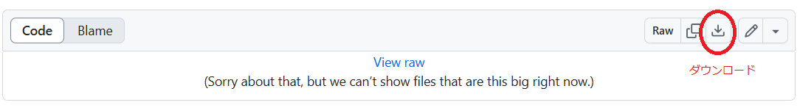
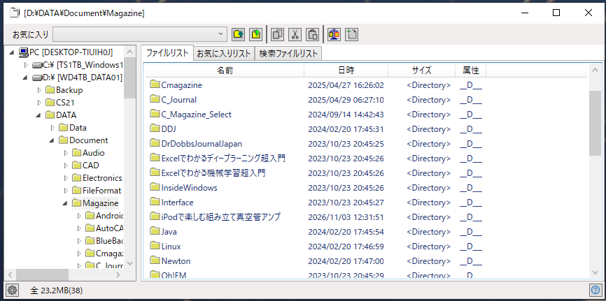
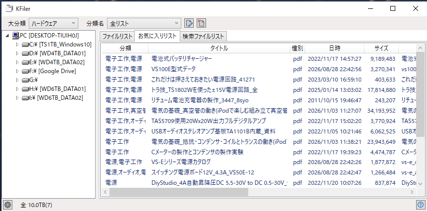
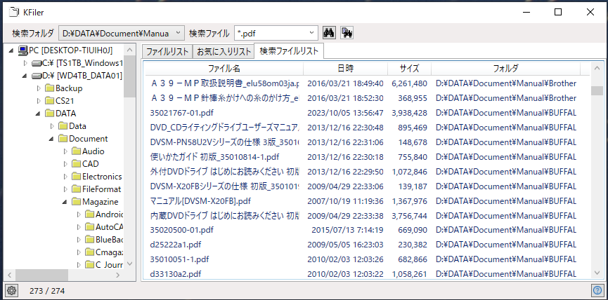
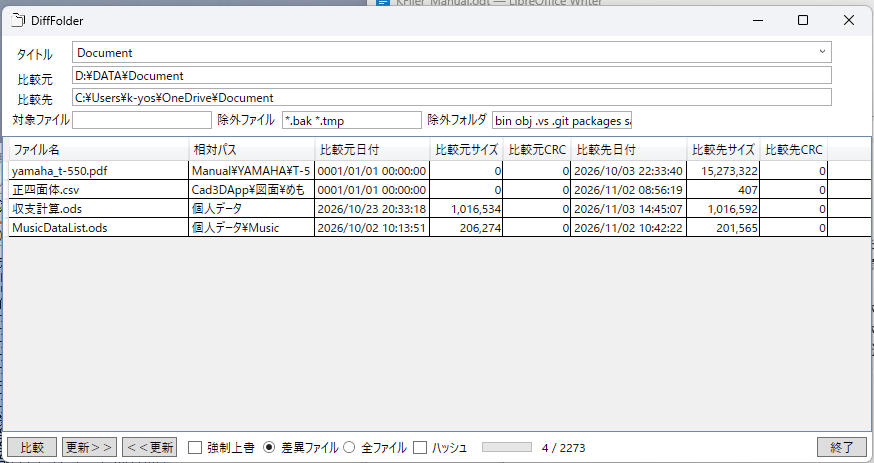
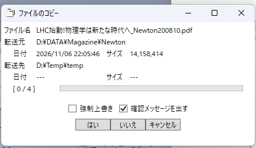
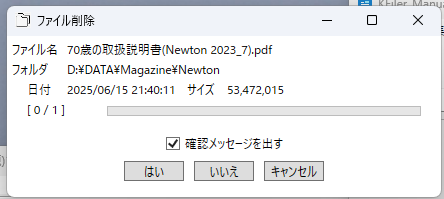
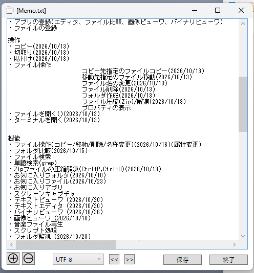
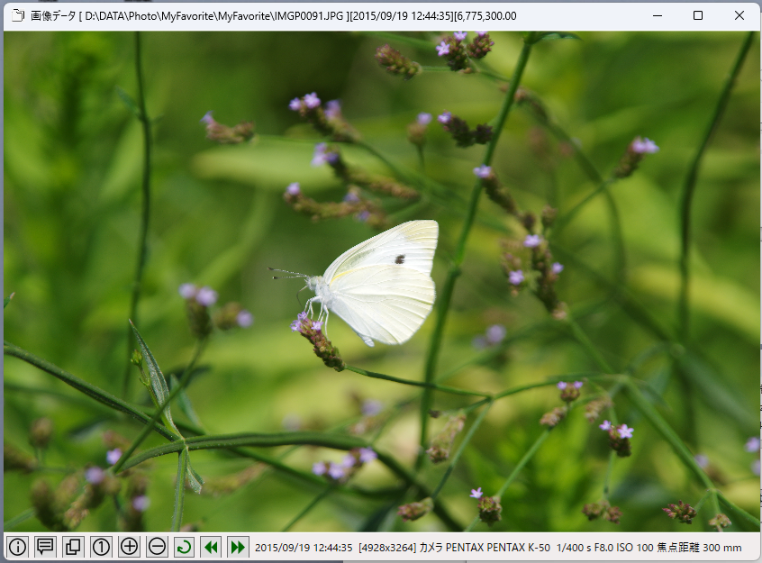
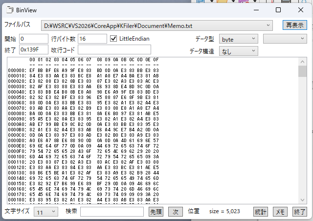

# KFiler
## ドキュメント管理を兼ねたファイラー  


ファイルリストとお気に入りのファイルを登録したお気に入りリストとをタブで切替として使用するファイラー  

使い方などは[説明書](Document/KFiler_Manual.pdf)を参照。  
実行方法は[KFiler.zip](KFiler.zip)をダウンロードし適当なフォルダーに展開して CadApp.exe を実行する。  


### 画面
#### メインウィンドウ(ファイルリスト表示)
  

## 機能
・ツリー表示によるディレクトリ操作   
・ファイル操作(コピー/移動/削除/名称変更)  
・クリップボードに対してコピー、切取り、貼付け  
・ファイルの圧縮解凍  
・フォルダ比較  
・テキストエディタ  
・イメージビューワ  
・バイナリビューワ  
・お気に入りへの登録  
・ファイルを開く  
・ターミナルを開く   

#### お気に入りリスト(ドキュメント管理)
  

## 機能
・登録されたファイルの分類表示(大分類、分類)  
・項目の編集  
・分類の追加  
・大分類間の移動、コピー  
・リストからの削除  
・ファイル操作(コピー、移動、削除)  
・ファイルの圧縮/解凍  
・テキストエディタ  
・イメージビューワ  
・バイナリビューワ  
・ファイルを開く  
・フォルダを開く  
・ターミナルを開く  

#### ファイル検索リスト表示
  

## 機能
・検索フォルダとファイル名(ワイルドカード)を指定して検索  
・お気に入りに登録  
・テキストエディタ  
・イメージビューワ  
・バイナリビューワ  
・ファイルを開く  
・フォルダを開く  
・ファイルの圧縮/解凍  
・ファイルのコピー、移動、削除  

## 操作
```
■ツールバー操作
[ファイルリスト]			[お気に入りリスト]		[検索ファイルリスト]
フォルダの選択			大分類の選択			検索フォルダの選択
フォルダの登録			分類の選択			検索ファイルの指定
上位フォルダへの移動		項目の編集			検索
ファイルをクリップボードにコピー	項目をリストから削除		Grep(未実装)
ファイルをクリップボードに切取り
クリップボードからファイルの貼り付け
フォルダ比較
お気に入りにファイルの登録

■コンテキストメニュー
[ファイルリスト]			[お気に入りリスト]		[検索ファイルリスト]
コピー [Ctrl+C]			開く [Ctrl+O]			開く [Ctrl+O]
切り取り [Ctrl+X]		内部エディタ [Ctrl+E]		お気に入りに登録 [Ctrl+S]
貼付け [Ctrl+V]			内部イメージビューワ [Ctrl+G]	内部エディタ [Ctrl+E]
ファイル操作			内部バイナリビューワ [Ctrl+B]	内部イメージビューワ [Ctrl+G]
ファイルコピー [C]		大分類のコピー  [R]		内部バイナリビューワ [Ctrl+B]
ファイル移動 [M]			大分類の移動  [M]               フォルダを開く [Ctrl+M]
ファイル名の変更 [R]		フォルダを開く [Ctrl+M]         ファイル圧縮 [Ctrl+P]
ファイル削除 [D]			分類追加  [S]                   ファイル解凍 [Ctrl+U]
フォルダ作成 [K]			編集  [H]                       コピー [C]
ファイル圧縮 [Ctrl+P]		ファイルコピー  [C]		移動 [M]
ファイル解凍 [Ctrl+U]		リストから削除  [D]		削除  [D]
お気に入りに追加 [Ctrl+S]
内部エディタ [Ctrl+E]
内部イメージビューワ [Ctrl+G]
内部バイナリビューワ [Ctrl+B]
開く  [Ctrl+O]
表示更新 [Ctrl+R]
ターミナルを開く [T]

■キー操作
[キー]      [ファイルリスト]         [お気に入りリスト]    [検索ファイルリスト]
Ctrl+A      全選択                  <==                    <==
Ctrl+B      内部バイナリビューワ     <==                    <==
Ctrl+C      クリップボードにコピー   <==                    <==
Ctrl+E      内部テキストエディタ     <==                    <==
Ctrl+G      内部イメージビューワ     <==                    <==
Ctrl+M                             フォルダ補開             <==
Ctrl+O      開                      <==                     <==
Ctrl+P      ファイル圧縮             <==                     <==
Ctrl+R      ファイルリストの更新
Ctrl+S      お気に入りに登録                                <==
Ctrl+U      圧縮ファイルの解凍                              <==
Ctrl+X      クリップボードに移動    <==                     <==
C           ファイルコピー          <==                     <==
D           ファイル削除            お気に入りから削除      ファイル削除
H                                   項目の編集				
K           ディレクトリ作成								
M           ファイル移動            大分類移動              ファイル移動
R           ファイル名変更          大分類コピー						
S                                   分類追加				
T           ターミナルを開く        <==                    <==
Enter       ファイルを開            <==                    <==
```


#### フォルダ比較
  

#### ファイルコピー/移動
  

#### ファイル削除
  


#### テキストエディタ
  


#### イメージビューワ
  


#### バイナリビューワ
  


### 履歴
2026/11/01 ファイル検索タブの追加  
2026/10/25 バイナリビューワ追加(CoreLib)、圧縮(Zip)/解凍(Zip,Gz,Tar)機能を追加  
2026/10/24 お気に入りリストを追加、フォルダ監視機能追加  
2026/10/18 ファイル操作機能(コピー、移動、削除、リネーム),フォルダ比較、テキストエディタ、画像ビューワ追加  
2026/10/12 初回登録  


### ■開発環境  
開発ソフト : Microsoft Visual Studio 2022  
開発言語　 : C# 10.0 Windows アプリケーション  
フレームワーク  :  .NET 8.0  
自作ライブラリ  : [CoreLib](https://github.com/katsushigeyoshida/CoreLib) (YLib, YFile, FileCopyDialog,FileDeleteDialog, InputBox)  


echo "# KFiler" >> README.md  
git init  
git add README.md  
git commit -m "first commit"  
git branch -M main  
git remote add origin https://github.com/katsushigeyoshida/KFiler.git  
git push -u origin main  

