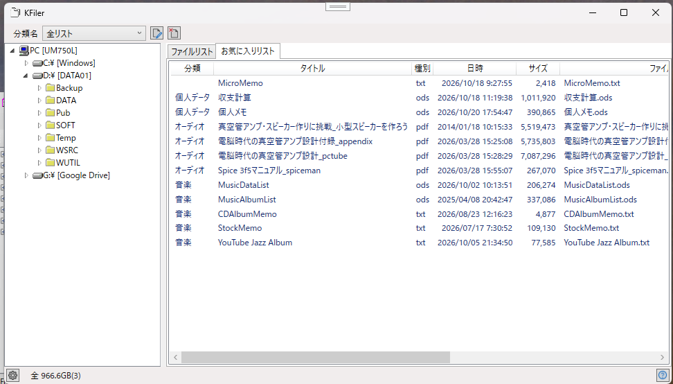

# KFiler
## ファイルエクスプローラもどきのファイラー

ファイルリストとお気に入りのファイルを登録したお気に入りリストとをタブで切替として使用するファイラー  

### 画面
#### メインウィンドウ
  

#### お気に入りリスト表示
  

## 機能
・ツリー表示によるディレクトリ操作  
・ディレクトリとファイルのリスト表示  
・お気に入りフォルダ  
・ファイル操作(コピー、移動、削除、リネーム)  
・クリップボード操作(コピー Ctrl+C(ファイルとパス)、切取り(Ctrl+X)、貼付け(Ctrl+V)  
・フォルダ比較  
・画像ビューワ  
・テキストエディタ  

### ファイルリスト表示
■ボタン操作  
フォルダの登録  
上位フォルダへの移動  
ファイルをクリップボードにコピー  
ファイルをクリップボードに切取り  
クリップボードからファイルの貼り付け  
フォルダ比較  
(ファイル検索)  
(Grep ファイル内単語検索)  
お気に入りにファイルの登録  
  
■コンテキストメニュー  
コピー  
切取り  
貼付け  
ファイル操作  
	ファイルコピー  
	ファイル移動  
	ファイル名の変更  
	ファイル削除  
	フォルダ作成  
	ファイル圧縮  
お気に入りに追加  
開く 
(プロパティ)  
ターミナルで開く  
  
■キー操作  
Ctrl+A		全選択  
Ctrl+C		クリップボードにコピー(ファイル/ファイルパス)  
Ctrl+E		内部テキストエディタ  
Ctrl+G		内部写真ビューワ  
Ctrl+O		開く(Zipファイルの解凍)  
Ctrl+P		ファイル圧縮(Zipファイル)  
Ctrl+R		ファイルリストの更新  
Ctrl+S		お気に入りに登録  
Ctrl+U		圧縮ファイル(ZIP/GZ/TAR)解凍)  
Ctrl+X		クリップボードに移動(ファイル/ファイルパス)  
C			ファイルコピー  
D			ファイル削除  
K			ディレクトリ作成  
M			ファイル移動  
R			ファイル名変更  
T			ターミナルを開く(PowerShell)  
Enter		ファイルを開く  

### お気に入りリスト表示
■ボタン操作  
分類選択  
選択項目の編集  
選択項目の削除  
  
■コンテキストメニュー  
開く 
分類追加  
編集  
削除 
  
■キー操作  
Ctrl+A		全選択  
Ctrl+C		クリップボードにコピー(ファイル/ファイルパス)  
Ctrl+E		内部テキストエディタ  
Ctrl+G		内部写真ビューワ  
Ctrl+O		開く  
Ctrl+P		ファイル圧縮(Zipファイル)  
Ctrl+X		クリップボードに移動(ファイル/ファイルパス)  
C			ファイルコピー  
D			お気に入りから削除  
H			項目の編集
M			ファイル移動  
S			分類追加  
T			ターミナルを開く(PowerShell)  
Enter		ファイルを開く  

### 履歴
2026/10/24 お気に入りリストを追加、フォルダ監視機能追加
2026/10/18 ファイル操作機能(コピー、移動、削除、リネーム),フォルダ比較、テキストエディタ、画像ビューワ追加  
2026/10/12 初回登録  

### ■開発環境  
開発ソフト : Microsoft Visual Studio 2022  
開発言語　 : C# 10.0 Windows アプリケーション  
フレームワーク  :  .NET 8.0  
自作ライブラリ  : [CoreLib](https://github.com/katsushigeyoshida/CoreLib) (YLib, YFile, FileCopyDialog,FileDeleteDialog, InputBox)  

echo "# KFiler" >> README.md  
git init  
git add README.md  
git commit -m "first commit"  
git branch -M main  
git remote add origin https://github.com/katsushigeyoshida/KFiler.git  
git push -u origin main  

