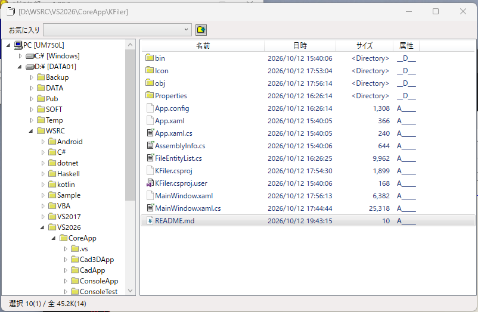

# KFiler
## ファイルエクスプローラもどきのフェイラー

### 画面
#### メインウィンドウ    
  

## 機能
・ツリー表示によるディレクトリ操作  
・ディレクトリとファイルのリスト表示  
・お気に入りフォルダ  
・ファイル操作(コピー、移動、削除、リネーム)  
・クリップボード操作(コピー Ctrl+C(ファイルとパス)、切取り(Ctrl+X)、貼付け(Ctrl+V)  
・フォルダ比較  
・画像ビューワ  
・テキストエディタ  

### 履歴
2026/10/18 ファイル操作機能(コピー、移動、削除、リネーム),フォルダ比較、テキストエディタ、画像ビューワ追加  
2026/10/12 初回登録  

### ■開発環境  
開発ソフト : Microsoft Visual Studio 2022  
開発言語　 : C# 10.0 Windows アプリケーション  
フレームワーク  :  .NET 8.0  
自作ライブラリ  : [CoreLib](https://github.com/katsushigeyoshida/CoreLib) (YLib, YFile, FileCopyDialog,FileDeleteDialog, InputBox)  

echo "# KFiler" >> README.md  
git init  
git add README.md  
git commit -m "first commit"  
git branch -M main  
git remote add origin https://github.com/katsushigeyoshida/KFiler.git  
git push -u origin main  

